# 从工具循环到 Code Mode

## Pi 架构演进：v0.9.4、v0.99.2 与 v1.4.0

**一部跟着源码读的中文电子书。** 本版依据官方仓库、固定版本源码和发布记录整理，核查日期为 2026 年 10 月 23 日，比较端点更新为 **v1.4.0**，正式发布时间为 2026 年 10 月 21 日。保留 v1.3.0 作为上一版参照，本书不把标签之后 `main` 上的代码混进来。

先说结论：Pi 的核心仍是“模型产生响应，工具执行操作，结果供下一轮模型使用”的循环。变化主要发生在循环外围：树形会话、统一扩展系统、更丰富的工具契约、内置 MCP，以及让模型用 JavaScript 编排工具的 **Code Mode**。仓库另外提供独立的实验性 Durable 运行时，可以恢复中断任务，但普通 CLI 没有切换到它，它也不是新内核。

本书沿用同目录学习课程的组织方式：一章解决一个问题，先建立直觉，再看图、沿源码追踪，最后做例子和练习。重点了解 Code Mode，可以先读第 1、3、5、6、8、11 章；想理解整套架构则顺序阅读。你只需了解基本 JavaScript、Promise，以及“模型能够请求调用工具”这一概念，不需要预先掌握编译器或 WebAssembly。

# 第 1 章：先把版本说清楚

**本章目标：弄清我们比较的是哪两个版本区间。**

`0.9.x` 和 `0.99.x` 不是同一组版本。版本号按整数元组比较，不是小数；次版本号 99 排在 9 之后。把两者混为一谈，就会把早已存在的能力误写成最新版本才出现。

| 参照点 | 日期及依据 | 为什么重要 |
|---|---|---|
| v0.9.4 | 2025-11-26，标签对应提交 | 可用的最后一个 0.9.x 标签；传输抽象、早期工具循环、线性会话文件 |
| v0.31.0 | 2026-01-02，变更日志 | 单文件内的树形会话与原地分支 |
| v0.35.0 | 2026-01-05，变更日志 | hooks 与自定义工具统一成 extensions |
| v0.99.0 | 2026-09-29，变更日志 | 内置 Code Mode、工具搜索、MCP 与嵌套工具契约 |
| v0.99.2 | 2026-09-30，变更日志 | MCP 按需发现，减少启动等待和工具描述变化 |
| v1.0.0 | 2026-10-01，变更日志 | 更精简的 Code Mode 提示、图像生成、默认全屏 TUI |
| v1.3.0 | 2026-10-15，正式发布 | 上一版参照；取消与 worker 数量控制、恢复活动工具集等修复 |
| v1.4.0 | 2026-10-21，正式发布 | 本版端点；worker 排队、摘要输出预算、图片分类及恢复边界修复 |

官方仓库现在叫 `earendil-works/pi`，历史上的 `badlogic/pi-mono` Git 地址仍能访问到这个项目。旧源码里的包名前缀是 `@mariozechner/*`，当前是 `@earendil-works/*`。改名是迁移时必须处理的事情，但改名本身不是一种新 Agent 算法。[S1](#s1)、[S2](#s2)

你原有的 `learning/pi-mono` 检出点显示为 `v0.54.0-1-g3a3e37d3`，而且存在本地修改。本次没有修改它，也没有升级当前安装的 Pi。`sources/` 单独保存四个用于比较的固定版本，新增 `pi-v1.4.0/`，不改动原有三个源码检出点。

### 本书说的“架构”包括什么

我们比较模块职责、依赖边界、数据流、状态归属、扩展方式和失败行为，不逐条复述所有模型新增和终端按键修复。完整的文件级变更清单另存于 `sources/`，需要穷尽排查时可以查阅。

书中区分三类内容：

- **已核实行为**：固定标签的文档、源码或发布记录能够支持。
- **教学模型**：为了讲清职责而简化的图和伪代码。
- **示意算术**：用于解释开销的假设工作量，不是实测性能。

### 不要被 diff 数字带偏

完整 Git 比较中，v0.9.4 到 v1.4.0 涉及 2,172 个变更文件；v0.99.2 到 v1.4.0 涉及 1,451 个；单独比较 v1.3.0 到 v1.4.0 则有 343 个。其中包含测试、文档、生成数据和实验代码的删除。尤其 v1.2.0 删除了尚未进入正式发布包的实验性服务端、客户端和插件栈。变更文件多、删除量大，并不等于正式 CLI 已经换成另一个分布式运行时。[S2](#s2)、[S18](#s18)

**理解检查：** 如果你以前用的是 v0.99.2，要知道 Code Mode 并非 v1.0 才出现；如果你比较的是 v0.9.4，则必须把中间接近一年的 harness 演进计算在内。

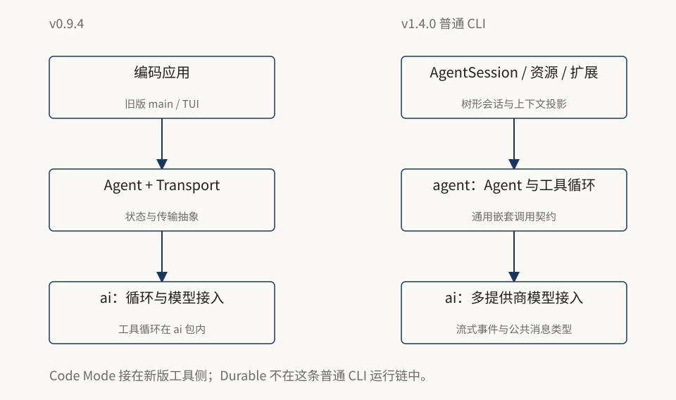

左边是旧版职责所在的位置，右边是新版普通 CLI 的对应层。图中强调的是代码归属与装配边界，并不表示所有能力都在同一个版本里完成迁移。

# 第 2 章：v0.9.4 原本是怎样工作的

**本章目标：先看清旧循环，再理解新增的编排层。**

v0.9.4 已经把模型提供商接入、有状态 Agent、编码应用和终端渲染拆开。它并不是“一段 shell 加一次模型调用”。

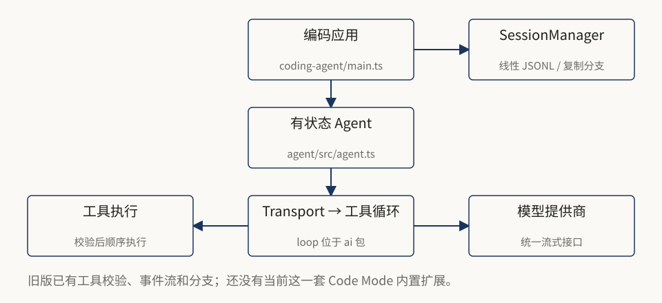

真正的循环在 **`packages/ai/src/agent/agent-loop.ts`**。有状态 `Agent` 在 `packages/agent/src/agent.ts`，接收 `AgentTransport`，通过 `transport.run(...)` 遍历事件。编码应用负责把这些模块装配起来。[S3](#s3)、[S4](#s4)

### 跟着一次请求走

假设你说：“读 package.json，告诉我包名。”

Agent 构造用户消息，把应用消息转换成模型能理解的消息，再交给 transport。循环接收模型流式响应。如果响应中包含 `read` 调用，就按名称查找工具、校验参数、执行 `execute()`，把结果变成 `toolResult` 加入上下文，再请求模型给出答案。

下面是教学伪代码，不是逐字摘录：

```js
while (hasToolCalls || queuedMessages.length > 0) {
  injectQueuedMessages();
  const assistant = await streamModel(context);
  for (const call of assistant.toolCalls) {
    const args = validate(call);
    const result = await findTool(call.name).execute(call.id, args, signal);
    context.messages.push(toToolResult(call, result));
  }
}
```

这里有两个历史事实。第一，**工具参数校验早就存在**，不能把它算作 Code Mode 才带来的能力。第二，旧循环通过带 `await` 的 `for...of` 逐个执行工具；当前 Agent 支持同一响应中的多个调用并行执行。[S4](#s4)、[S6](#s6)

### 状态分别放在哪里

Agent 维护消息、当前模型、流式状态、待执行调用 ID 和消息队列。消息转换器负责把附件等应用数据变成模型输入。事件流让 UI 观察 `message_start`、`message_update`、`message_end`、工具执行和回合边界。

旧 `SessionManager` 使用 JSONL，保存会话头、消息、模型变更和思考等级变更。条目没有当前的 `id` / `parentId` 树形链接。`createBranchedSession()` 会新建文件，把分支点之前的消息复制过去。所以旧版**并非没有分支**，只是把历史复制到新文件，不同于当前在一个文件中切换树形分支。[S5](#s5)

### 那时还没有什么

该标签没有当前这一套内置 Code Mode、MCP、tool search 组合，也没有后来统一的扩展系统。仓库还包含 `mom`、`web-ui`、`pods`、`proxy` 等应用或配套模块。说明多界面复用从早期就重要，但不意味着这些目录现在仍原封不动地存在。

**练习：** Anthropic 流式事件归一化应该放哪里？模型接入层。重画终端一行放哪里？TUI。判断是否继续下一轮模型请求放哪里？Agent 循环。文件位置虽变，职责判断仍然有效。

# 第 3 章：当前架构，分清 CLI 与独立基础库

**本章目标：看到整张地图，但不把相邻模块当作同一条执行链。**

v1.4.0 的 CLI 仍建立在有状态 `Agent` 上，不过循环已经并入 Agent 所在的包：**`packages/agent/src/agent-loop.ts`**。编码应用层提供 `AgentSession`、会话持久化、上下文投影、资源加载、扩展、模型运行时和不同交互接口。[S6](#s6)、[S7](#s7)

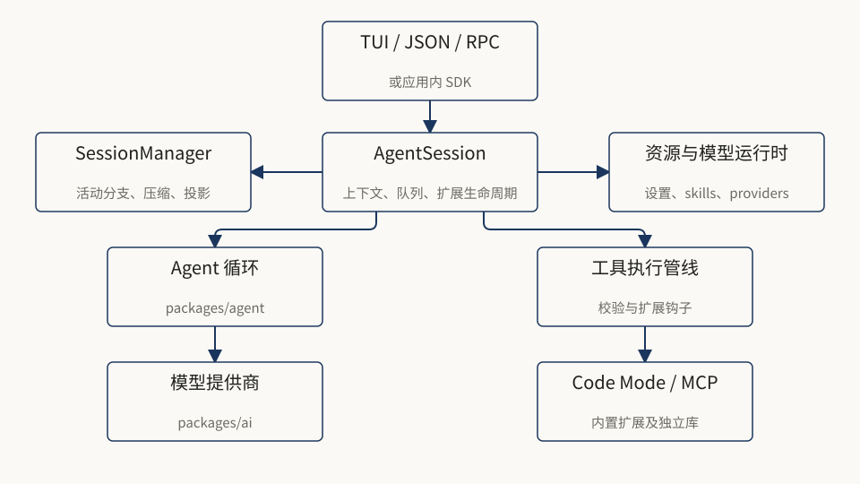

这张图表达的是职责划分，不是完整的 npm 依赖图。Code Mode 和 MCP 通过 CLI 的内置扩展接入，没有替换 Agent 或模型接入层。

### 每个包负责什么

| 目录 | 主要职责 | 与普通 CLI 的关系 |
|---|---|---|
| `ai` | 多提供商模型、流式事件、公共内容类型 | 模型基础层 |
| `agent` | 有状态 Agent、模型/工具循环、队列、事件 | 核心循环 |
| `coding-agent` | CLI、AgentSession、资源、扩展、会话、SDK、RPC | 产品与 harness 层 |
| `tui` | 差分终端渲染 | 交互展示 |
| `codemode` | 独立 QuickJS 沙箱及脚本协议 | 被内置 Code Mode 扩展调用 |
| `mcp` | 独立 MCP 客户端 | 被内置 MCP 集成调用 |
| `telemetry` | 厂商无关的观测契约、类型与 schema 工具 | 配套基础库，`ai` 依赖它 |
| `durable` | 实验性持久会话、任务、文档运行时 | 独立 runtime，不是默认 CLI 内核 |
| `env` | Durable 的远程执行客户端和 Rust daemon | 可选远程基础设施 |
| `chord` | 类型化 runtime、文档状态、RPC 基础设施 | Durable 使用它；CLI 在 v1.2.0 去掉了直接依赖 |
| `evals` | 仓库内的评估工具 | 开发工具，不是用户请求必经阶段 |

这些关系依据固定版本的 `package.json` 确认。根 README 的包表不是完整目录清单，部分新包未列入；反过来，仓库里存在某个包，也不意味着 CLI 依赖它。确认依赖关系时，优先查看 `coding-agent/package.json`。[S8](#s8)

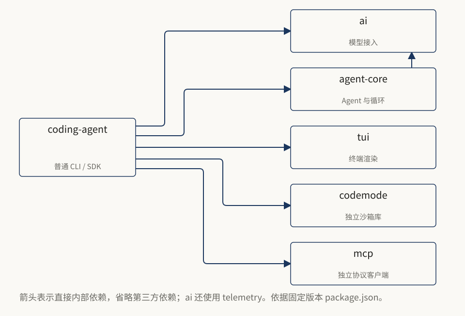

上图专门回答“安装和维护普通 CLI 时，哪些内部包需要一起保持版本一致”。不要将它与上一张运行时职责图的调用方向混读，也不要因为仓库有 Durable，就把 Durable 画成 CLI 的必经内核。

### 用三个边界理解后面的所有章节

**推理边界：** 模型决定目标、调用和代码；Code Mode 中的常规循环、条件、聚合由 JavaScript 执行，不必每个中间结果都重新问模型。

**上下文边界：** harness 决定下一次模型请求看到什么。磁盘历史、UI 展示、嵌套调用记录和模型上下文不是同一份东西。

**能力边界：** 脚本只能调用注入的能力，但注入的 shell 工具可能拥有 Pi 进程的全部权限。JavaScript 沙箱不等于 shell 的文件系统沙箱。

后面的章节沿着这三个边界展开。比起记住一串类名，这样更容易解释设计为什么发生这些变化。


# 第 4 章：一次请求的完整生命周期

**本章目标：区分消息流、持久历史和模型输入。**

先跟踪一条请求，看输入怎样变成模型上下文、工具调用和最终结果。

1. CLI、SDK 或 RPC 收到输入。提示模板可先展开，扩展可以处理命令或变换输入。
2. `AgentSession` 负责运行准备、模型与工具配置、压缩检查、扩展生命周期和队列。
3. `SessionManager` 从当前叶子追溯活动分支，重建已定稿的上下文。
4. harness 组合系统提示、分支消息、工具声明和模型设置，交给 provider。
5. provider 产生流式事件，Agent 归一化为消息和回合事件。
6. 如果 assistant 请求工具，则校验、触发扩展钩子、执行，记录结果。
7. 如果还有工具结果或队列需要处理，则继续；否则进入最终收尾。

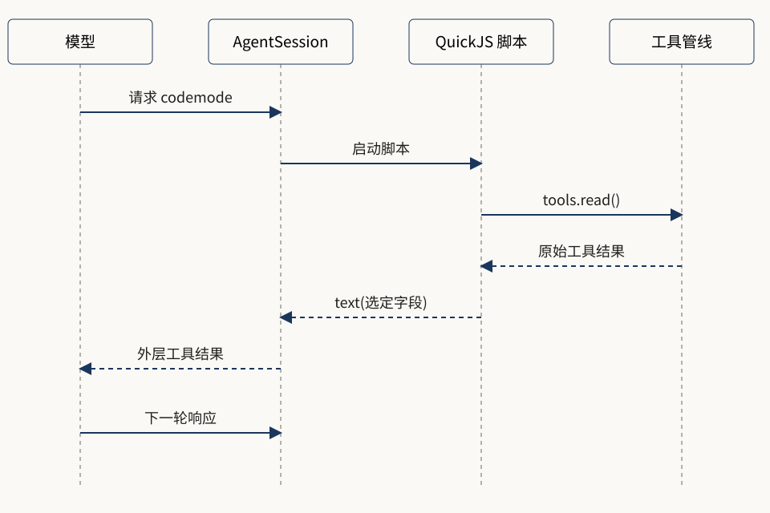

图中省略流式 token 与多轮重试，保留了最重要的边界：**嵌套工具结果先回给脚本，而不是直接变成下一次模型输入。** [S7](#s7)、[S9](#s9)、[S10](#s10)

### 同一响应的并行，不等于 Code Mode

当前 Agent 的工具执行默认支持并行：先按顺序做调用前检查，再并行执行被允许的工具；完成事件按实际完成顺序发出，最终的工具结果消息仍按 assistant 源码中的调用顺序写入历史。需要共享状态的工具可以选择顺序执行。[S6](#s6)

这意味着：模型在一个响应里同时请求三次 `read`，不使用 Code Mode 也可能并行。Code Mode 多出的价值是**在一个脚本中表达依赖、分支、过滤与聚合**，并控制哪些结果跨回模型边界，而不只是“把串行变成并行”。

### 三种历史不要混淆

| 视角 | 保存或展示什么 | 用途 |
|---|---|---|
| 原始会话历史 | 消息、分支、压缩、上下文编辑、配置变化、自定义状态等 | 追溯、恢复、导出 |
| UI 和执行事件 | 流式输出、嵌套工具进度、完成时长等 | 观察正在发生什么 |
| 模型上下文投影 | 活动分支经过压缩、上下文编辑、消息转换后的输入 | 下一轮模型推理 |

当前 JSONL 条目通过 `id` / `parentId` 组成树。`/tree` 可以从旧节点继续，同时保留被放弃分支。压缩追加摘要和保留边界，而不是删除原始历史；`context_edit` 可以让某个历史条目在未来模型上下文中被省略或替换，但不重写其原始记录。[S11](#s11)

### 压缩和 Code Mode 各解决什么

默认压缩阈值的概念是：

```text
contextTokens > contextWindow - reserveTokens
```

Code Mode **在信息进入模型之前就做减量**；压缩则是在上下文已经积累后，把早期内容总结成摘要。前者不能替代后者。普通工具调用也可以先截断输出；Code Mode 更适合按数据含义做结构化筛选。[S12](#s12)

例如运行测试得到很长日志。工具截断保留头尾，不知道你只关心三个失败断言；脚本可从结构化结果中选出失败项，再让模型理解原因。但如果你把全部日志 `text()` 出去，就没有获得这部分上下文收益。

### v1.4.0：何时压缩，与摘要能输出多长是两回事

`compaction.reserveTokens` 仍决定自动压缩何时开始，但不再按它为摘要请求算一个固定输出上限。v1.3.0 的主摘要曾取 `floor(0.8 × reserveTokens)` 与模型输出上限中的较小者；当推理内容占用额度时，正文摘要可能还没写完就结束了。v1.4.0 改用模型输出上限，并在必要时让输入与输出共同适配上下文窗口。所以“移除固定上限”不表示输出无限，也不表示摘要一定成功。[S12](#s12)、[S28](#s28)

用教学数值手算：上下文窗口 128,000，预留 16,384，则超过 111,616 时触发自动压缩；旧主摘要按比例算出的上限约为 13,107。新版不会因为预留值相同，就把摘要仍然限制在 13,107。扩大预留值主要让压缩更早发生，不应再用它间接调整摘要长度。

分支总结也采用新输出预算。导出的 `generateSummary()` 和 `generateSummaryWithUsage()` 为兼容旧调用保留参数位置，但忽略原来的 `reserveTokens` 参数；维护自定义调用时要重新核对意图。`/compact 保留未解决问题` 之类指令也会传给被切开的回合前缀摘要，修复了此前这部分忽略指令的问题。

### v1.4.0：截断恢复后，工具消息仍要成对

模型在输出上限处被截断，可能留下不完整的工具调用。历史转换不能只丢掉调用请求，却把对应工具结果交给下一轮 provider；孤立结果会使后续请求持续被拒绝。v1.4.0 修复了这条恢复路径。此处说的是模型响应截断后的协议一致性，不是工具长输出被截断后的 JSON 解析问题。[S2](#s2)

### 什么时候才算真的结束

SDK 的 `agent_end` 只代表一次底层 Agent 运行结束，之后还可能发生自动恢复、重试或排队工作。集成程序要确认 Pi 不再自动继续，应该关注 **`agent_settled`**。把两者当成同一个事件，会导致 UI 过早解除忙碌状态，或者脚本过早退出。[S9](#s9)

**理解检查：** 从树中切回旧节点，会不会回滚已经写入的文件？不会。会话分支描述对话历史，不是文件系统快照。

# 第 5 章：Code Mode 到底改变了什么

**本章目标：能用一句话解释它，并知道何时不该使用。**

**让模型写一段调用工具的 JavaScript，常规编排在脚本中完成，只把主动输出的内容交还模型。**

普通工具模式下，工具编排分散在 assistant 的工具请求及其后续模型响应中。Code Mode 把部分编排移到程序执行侧，模型看到一个外层 `codemode` 调用，脚本内部可以调用很多工具。底层工具仍然是真实工具。[S10](#s10)

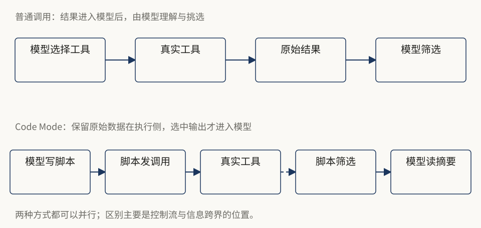

### 一个具体任务：检查三个 package.json

需求：“读取根目录、api 和 web 的 package.json，只告诉我包名与 scripts 里有没有 test。”

不用 Code Mode，模型可以请求三次 `read`，收下三个完整文件，再挑选字段；也可以请求 shell 直接聚合，或调用专门工具。Code Mode 不是唯一能做聚合的办法。

使用 Code Mode，可以表达为：

```js
const paths = [
  "package.json",
  "packages/api/package.json",
  "packages/web/package.json",
];

const rows = await Promise.all(paths.map(async (path) => {
  const raw = await tools.read({ path });
  const pkg = JSON.parse(raw);
  return { path, name: pkg.name, hasTest: Boolean(pkg.scripts?.test) };
}));
text(rows);
```

假设三个文件都是未截断的有效 JSON，脚本内部会拿到全部内容，模型只收到选出的字段。`read` 返回的是字符串，不应写成 `raw.output`。如果读的是超大文件，被工具截断后就可能不是有效 JSON；应换成专门读取并解析的工具，或通过受控 shell 生成少量结构化数据。Code Mode 不会自动修复上游工具截断。

### 把控制流也写进去

如果其中一个包不存在，上一段的 `Promise.all()` 会让整个表达式失败。读取多个独立来源时，更实用的版本是：

```js
const paths = ["package.json", "missing/package.json"];
const results = await Promise.allSettled(
  paths.map(async (path) => JSON.parse(await tools.read({ path })))
);
text(results.map((r, i) => r.status === "fulfilled"
  ? { path: paths[i], name: r.value.name }
  : { path: paths[i], error: String(r.reason) }
));
```

`Promise.allSettled()` 会返回每项调用的成功值或失败原因，后续逻辑需要分别处理。放在同一个并发数组里的调用应互不依赖；写文件后再读取它，要按顺序执行。

### 上下文收益怎么估算

下面只是示意，不是 Pi 性能测试。设有 N 个独立调用，每个原始结果 R 个字符，最终每项只需要 S 个字符。

```text
全部原样返回：约 N × R
脚本选择字段：约 N × S + 外层包装
```

若 N = 12、R = 20,000、S = 300，数据量从约 240,000 个字符变成约 3,600 个字符，再加脚本和结果包装。**字符不是 token**，也不是费用；实际还受工具定义、模型分词、缓存和输出限制影响。这个例子只说明“把不需要的数据留在执行侧”的价值。

### 哪些事不值得套一层脚本

只读一个短文件，直接 `read` 通常更简单；要跑整个项目测试，直接 `bash` 就可能够了；需要长时间重型计算，QuickJS 也不比专门程序合适。不要为了使用 Code Mode，把本来一行能讲清的请求改成难读程序。

Code Mode 在工具输出与模型上下文之间增加了可编程的数据处理层，依赖、过滤和聚合都可以在这里完成。

# 第 6 章：拆开沙箱，看见真正的调用链

**本章目标：知道脚本在哪里运行，权限检查在哪里发生。**

普通 CLI 的 Code Mode 由两层组成：`packages/codemode` 提供通用沙箱；`coding-agent/src/extensions/codemode` 负责把它接到 Pi 的工具、会话、展示和模型运行时。前者没有 Pi 内部包依赖，因此也能脱离编码代理单独使用。[S13](#s13)

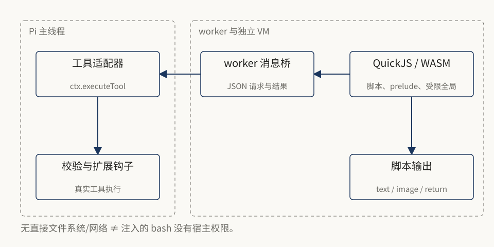

### 从源码追一次 tools.read()

1. `tool.ts` 定义 `codemode` 工具、输入形式和模型可见说明。
2. executor 读取当前可调用工具 `ctx.tools`，把每个工具包装成沙箱能力。
3. 创建 `CodemodeSandbox`，设置 QuickJS WASM、worker 入口、内存限制和 worker 准入控制。
4. `execute()` 启动 worker，在独立 WASM 实例中创建新的 QuickJS VM。
5. VM 内的 prelude 暴露 `tools`、`text`、`image`、`console`、`store` / `load` 等接口，桥接函数藏在闭包中。
6. 脚本调用 `tools.read(...)`，消息经过 worker 桥返回主线程。
7. 主线程调用 **`ctx.executeTool()`**，进入参数校验及 `tool_call` / `tool_result` 钩子。
8. 结果被转换成脚本值，返回 VM；脚本选择性输出。
9. executor 关闭沙箱、处理状态写入、截断输出、保存图片、生成外层工具结果。

在 v1.4.0 的 `execute.ts` 中，关键语句仍是：

```ts
const outcome = await ctx.executeTool(tool.name, args, { signal: callSignal });
```

它解释了为什么“脚本里的工具调用”不是绕开工具链直接执行函数。已有扩展实现的拦截与权限确认仍然可以生效。不过 Pi **没有内置一套对每次调用逐一确认的默认权限系统**；这里说的是扩展钩子可以执行权限策略，不是默认已经有一层强制审批。[S14](#s14)、[S15](#s15)、[S25](#s25)

### 为什么不用 Node 的 eval

脚本里没有 Node API、文件系统、网络、模块加载和定时器。不能直接使用 `process`、`require`、`fetch` 或 `setTimeout`，需要访问外部世界就通过注入工具。`eval` / `Function` 即使存在，也只能在同一个 VM 里生成更多代码，不凭空获得宿主能力。

QuickJS 是解释器，编译为 WebAssembly 后运行在 worker。worker 避免一段同步死循环卡住 Pi 主线程；WASM 实例分离 VM 内存；能力注入限制脚本可以接触的接口。这是分层设计，不是一句“用了沙箱所以绝对安全”。

### 限制属于哪一层

| 层次 | 典型限制或职责 |
|---|---|
| 脚本源格式 | 第一行可选 `// @options:`；错误位置或非法字段会报错 |
| VM | CLI 每脚本 256 MiB 堆限制，无法分配时失败 |
| 宿主/worker | deadline、abort、worker 生命周期与数量限制 |
| 输出收集 | 16 Mi 字符及 100,000 个输出项目上限 |
| 模型结果格式化 | 默认约 10,000 输出 token 预算，超长保留头尾并保存完整文本 |
| 底层工具 | 参数、外部进程、远程调用、工具自身截断与超时 |
| 操作系统或容器 | 文件、进程、网络与凭据的真正权限边界 |

这些限额不能混用。256 MiB 是 CLI 集成的选择，不是所有独立沙箱部署的通用默认；Cloudflare 默认限制又不同。外层输出 token 预算也不是 VM 内存限制。[S10](#s10)、[S13](#s13)

### 一个危险的误解

```js
await tools.bash({ command: "某个有破坏性的命令" });
```

命令执行发生在工具能力背后，能接触什么取决于 Pi 进程或工具专属容器，不取决于 QuickJS 是否能直接读文件。需要强隔离时，应限制容器挂载、网络、账户和凭据；只限制 JavaScript 全局变量远远不够。

**源码阅读顺序：** `tool.ts` → `execute.ts` → `codemode/src/runtime/host.ts` → `worker.ts` → `vm.ts` → `prelude-source.ts`。先沿着一次调用走通，再研究声明生成和模型辅助接口。


# 第 7 章：工具太多时，怎样发现而不塞满提示

**本章目标：分清“注册”“向模型声明”和“可被脚本调用”。**

常见思路是把所有工具的名称、说明和参数 schema 都放进模型请求。工具少时这样做很直观；但面对几十个服务、几百个工具，它会撑大提示、干扰模型选择，工具集的变动还会波及缓存。

Pi 把这几件事拆开了：工具可以已注册却不直接声明给模型，可以供脚本调用却不出现在 Code Mode 说明里，也可以按需搜索后再声明。**不可见不等于不可用，也不等于权限已被撤销。** [S16](#s16)、[S17](#s17)

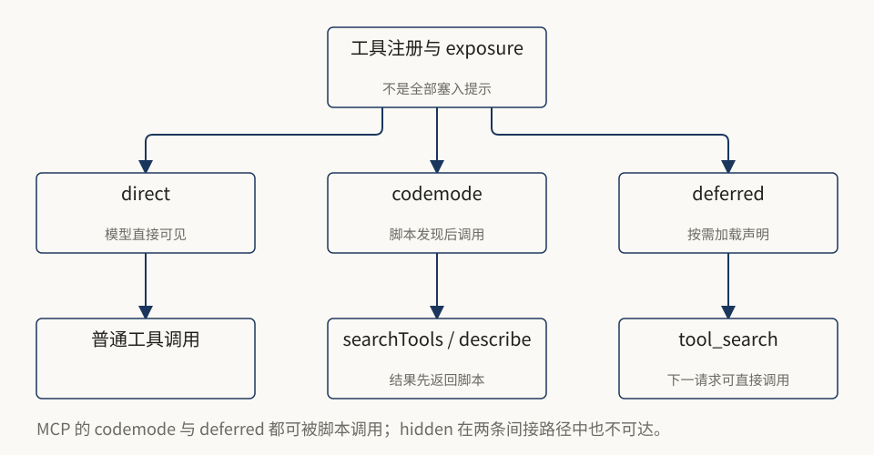

### MCP 的四种 exposure

| MCP exposure | 默认向模型声明？ | 脚本可调用？ | 常见用途 |
|---|---|---|---|
| `direct` | 是，受当前工具选择约束 | 是 | 少量高频工具 |
| `codemode` | 否，默认也不列入 Code Mode 描述 | 是 | 大多数服务，先发现再组合 |
| `deferred` | 否；`tool_search` 可加载声明 | 是 | 希望发现后按普通工具直接调用 |
| `hidden` | 否 | 否 | 保留注册信息但使其不可达 |

MCP 默认使用 `codemode`。普通扩展工具还有 `model-only`，适合仅让模型直接调用、禁止其他工具间接调用的编排器或问答工具。不要把 MCP 配置表和扩展底层表机械合并：MCP 集成会处理命名空间和延迟发现，最终可达性还取决于禁用、过滤与活动集合。[S15](#s15)、[S16](#s16)

### 四个发现入口，各做一件事

```js
const hits = await searchTools("search documentation", { limit: 3 });
text(hits);
```

- `ALL_TOOLS`：当前可调用目录，包含名称和说明。
- `searchTools(query, options)`：BM25 相关性排序，找候选。
- `describeTool(name)`：获得某个工具的说明与 TypeScript 声明。
- `describeNamespace(name)`：读某个命名空间的指令和工具信息。

三个查询 helper 都是异步接口，调用时必须 `await`。BM25 做的是文本检索，并不理解业务语义；搜索词和工具说明写得如何，会直接影响结果质量。发现之后要先确认参数，不能猜个名字就直接调用。[S10](#s10)

示意流程如下，其中 `hits[0]` 只是候选，必须读完说明再决定是否合适：

```js
const hits = await searchTools("read documentation page", { limit: 3 });
if (hits.length === 0) return "没有找到候选工具";
text(await describeTool(hits[0].name));
```

发现结果会在这一轮交还模型，模型下一轮再据此编写准确的调用。发现和执行不必都挤在同一个脚本里。

### codemode.mode 的 on 与 only

`on` 是默认模式：已声明的工具继续直接可见，同时附带脚本调用提示。`only` 则隐藏这些底层工具的直接声明，把调用入口集中到 Code Mode；但可调用的集合本身不会因为声明被隐藏而消失。

```json
{
  "defaultTools": ["+codemode"],
  "codemode": { "mode": "on", "inlineBudget": 3000 }
}
```

`inlineBudget` 是对声明文本的 token 预算估计，大约按字符数除以四折算，并非精确分词。超出预算的工具交给发现接口查找。当前默认的 MCP 工具本就不会逐个写进 Code Mode 描述。`only` 属于呈现和编排策略，不提供更强的 OS 沙箱隔离。[S17](#s17)

### 为什么 MCP 不阻塞每次启动

从 v0.99.2 起，非 direct 服务器不再阻塞首个 prompt，而是先在后台连接；等到脚本点名某个服务器，或需要搜索全部工具时，再等待相关连接完成。当前用 `reachesTools(input)` 描述编排器可能触及哪些工具或命名空间，MCP 扩展据此等待必要的服务器。搜索整个目录意味着可能触及全部工具，所以要等更多服务就绪。[S2](#s2)、[S15](#s15)、[S16](#s16)

v1.2.0 将 MCP 与 Code Mode 解耦，意义也在这里：MCP 不再到处硬编码去“识别某个内置实现”，而是通过通用工具契约判断编排器的可达范围。替换同名编排工具时，需要一并提供相应的 `reachesTools` 契约。

### 一个容易造成权限误判的 CLI 细节

```sh
pi --tools read,codemode
```

在当前版本中，这条命令**不会自动删除 MCP 工具**，它们仍可能被脚本调用。要去掉 MCP，用 `--no-mcp`；按 MCP 名称筛选用 `mcp__` 模式；排除工具用 `--exclude-tools`。不能只读 allowlist 的表面含义，就当成完整的权限审计。[S16](#s16)、[S19](#s19)

# 第 8 章：结果、失败、并发与状态

**本章目标：写出在真实失败中仍然可理解的脚本。**

Code Mode 最容易写错的地方在返回值和失败契约，而不是语法。不要假定所有调用都返回字符串，也不要假定失败一定以 throw 的形式出现。

### 三种常见结果

| 工具 | 脚本通常拿到什么 | 需要检查什么 |
|---|---|---|
| `read` 读文本 | 字符串 | 是否被截断，是否符合预期格式 |
| `bash` | `{ output, exit_code, truncated, full_output_path?, ... }` | `exit_code`，即使 Promise fulfilled 也可能执行失败 |
| MCP 工具 | `CallToolResult`，包括 `content`、`structuredContent`、`isError` | `isError` 与实际字段，不要只读第一条文本就宣布成功 |

声明了 output schema 的工具可以把结构化值交给脚本，错误结果也可能携带结构化值。校验失败、被拦截、没有对应数据等执行异常可以 reject。MCP 会保留完整的结果对象，所以 `isError` 必须显式检查。最终以发现接口返回的声明和该工具的契约为准。[S10](#s10)、[S14](#s14)、[S16](#s16)

```js
const result = await tools.bash({ command: "npm test" });
if (result.exit_code !== 0) {
  text({ passed: false, tail: result.output.slice(-4000) });
} else {
  text({ passed: true });
}
```

对 MCP，下面仅表达检查方式，工具名和参数都是教学占位，需先用发现接口确认：

```js
// 伪代码：先发现真实工具，不要原样运行。
const result = await tools.mcp__docs__search({ query: "session" });
if (result.isError) throw new Error(JSON.stringify(result.content));
text(result.structuredContent ?? result.content);
```

### 两个层次的成功

`Promise.allSettled()` 返回 fulfilled，只说明 Promise 没有 reject，既不说明 shell 退出码为零，更不说明业务成功。可靠脚本会先看 Promise 状态，再看结果里的错误标志或退出码。

类似地，独立沙箱 `sandbox.execute()` 遇到脚本错误时通常返回 `{ ok: false, error }`，而不是直接 reject。脚本、宿主调用和模型 API 处在不同层次，错误表示并不通用。

### await 是生命周期的一部分

```js
// 错误示例：脚本可能先结束，未完成调用会被取消。
tools.read({ path: "package.json" });
return "完成";
```

```js
// 正确示例：确认依赖工作已完成。
const source = await tools.read({ path: "package.json" });
text(JSON.parse(source).name);
```

脚本结束时，尚未完成的调用会被请求取消；已经完成的外部副作用不会回滚。`Promise.all()` 因为其中一项失败而提前 reject，也可能让外层脚本结束，进而取消其他仍在进行的调用。彼此独立的读取适合用 `allSettled()`，有依赖关系的操作则按顺序执行。

### store 不是数据库事务

`store(key, value)` / `load(key)` 保存小型 JSON 状态。CLI 只有脚本成功后，才把变更追加为 `codemode-store` 自定义会话条目；恢复和树形分支都只重放当前路径上的状态。单值 JSON 长度上限为 262,144 字符，总量为 1,048,576 字符。[S10](#s10)、[S14](#s14)

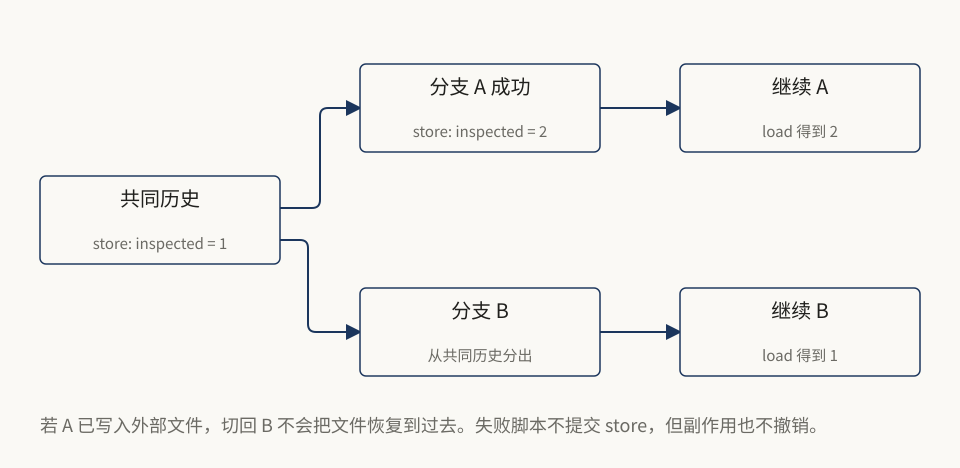

```js
const count = (load("inspected") ?? 0) + 1;
store("inspected", count);
text({ count });
```

如果脚本后面 throw，状态写入不会提交；但此前通过 `write` 修改的文件可能已经变更。所以“失败不提交 store”并不等于“失败回滚整个脚本”。同理，在分支 A 保存的游标不会自动出现在从更早节点分出的分支 B 中，而文件系统对两者仍是同一份现实。

适合存：查询游标、选中的 ID、短摘要。不要存大型日志、图片 base64、完整仓库文件；大数据应由文件或外部服务承载。

### 取消不代表 worker 已经退出

CLI 默认最多允许同一 Pi 进程中两个 Code Mode worker 存活，跨会话共享；v1.4.0 可以用环境变量 `PI_CODEMODE_MAX_WORKERS` 指定正整数上限，非法值回退到默认 2。Bun 下，某些不轮询中断的内建操作可能在返回取消结果后继续运行，直到该操作结束。v1.3.0 的修复把“对用户立即返回取消”和“实际 worker 退出后释放名额”拆开，避免重复取消积累残留 worker。[S2](#s2)、[S13](#s13)、[S14](#s14)

这个区别很通用：**响应完成、任务停止、资源回收完成，是三个不同时间点。** 不能在 timeout 返回的瞬间就把并发名额无条件释放。

### v1.4.0：容量用尽时先排队，不是立即失败

v1.3.0 引入真实 worker 数量限制，但名额满时会立即拒绝新脚本。v1.4.0 的 `reserveCodemodeWorker()` 先把等待者加入队列；`admitCodemodeWorkers()` 按到达顺序放行，`releaseCodemodeWorker()` 在实际释放后继续准入。[S26](#s26)

等待最多 60 秒，并且计入脚本整体的 `timeout_ms`。假设脚本总时限 10 秒，排队花掉 8 秒，剩下最多只能执行约 2 秒，不会在拿到名额后再补一份完整的 10 秒。等待超时或被取消的请求会从队列移除；没有获得名额就不会启动 VM。

“两个 worker”并不等于“脚本里只能并发两个工具”。脚本中彼此独立的工具调用不会逐项占用这两个名额；`models.classify()` 和 `models.generateImages()` 另有每脚本最多 4 项在途调用的限制。调高 worker 上限会增加潜在的内存与外部调用压力，并不等于免费提升吞吐。

排队也不等于解决所有相互等待：脚本持有 worker，又等同进程中的另一个脚本获取名额，仍可能形成资源等待。60 秒等待上限提供失败出口，不提供无限递归子代理能力；脚本不能直接启动另一个 `codemode`。

### 四类常见错误的处置

| 症状 | 先检查什么 | 合理恢复 |
|---|---|---|
| `tools.X` 不存在 | 拼写、标识符规范、工具是否可达 | 重新发现并描述工具，不反复猜名字 |
| JSON.parse 失败 | 是否读到截断输出、日志或错误页面 | 换结构化工具或缩小读取内容 |
| 等待空闲 worker 超时 | 全进程名额、残留 worker、相互等待和总 deadline | v1.4.0 已自动排队；先查占用，不做高频重试 |
| 超时或部分成功 | 哪些调用已产生副作用 | 查明实际状态，再决定是否重试；写操作需幂等策略 |

# 第 9 章：扩展、模型与界面，哪些没被 Code Mode 替代

**本章目标：知道新增功能应该放在哪一层。**

定制需求并不都由 Code Mode 承担。模型生成的短程序编排归它；安装到 harness 的可执行行为归扩展；按需指令归 skill；复用输入归提示模板；配色归主题。这些能力彼此互补。

### 扩展：从分散机制到一个入口

v0.35.0 把 hooks 与自定义工具统一成 extensions，并把文件式 slash commands 改称 prompt templates，避免和真正注册的命令混淆。当前 TypeScript 扩展工厂接收 `ExtensionAPI`，可以注册工具、命令、事件处理器、模型提供商、渲染器等。[S2](#s2)、[S15](#s15)

最小例子：

```ts
import type { ExtensionAPI } from "@earendil-works/pi-coding-agent";

export default function (pi: ExtensionAPI) {
  pi.registerCommand("hello", {
    description: "显示问候",
    handler: async (name, ctx) => {
      ctx.ui.notify(`你好，${name || "世界"}`, "info");
    },
  });
}
```

扩展直接运行在 Pi 进程中，能够接触文件、凭据与会话，不受 QuickJS 脚本那组全局变量限制。加载不可信扩展，比阅读一份不可信文档具有更直接的执行风险。

### 生命周期与状态放置

扩展工厂负责注册，不宜直接启动 watcher、socket、定时器。因为有些命令只加载扩展，并不启动会话。长寿命资源应在 `session_start` 或实际需要时开启，并在 `session_shutdown` 幂等清理。

分支相关工具状态可以放工具结果 `details`；不进入模型的持久数据用 `appendEntry()`；希望进入模型的自定义内容用 `sendMessage()`；跨会话数据用外部存储。重建状态应读取 `getBranch()`，不是遍历整个文件把其他分支也合并。[S15](#s15)

### Provider 仍然承担协议适配

Code Mode 不会消除 Anthropic、OpenAI、Google 等协议差异，模型接入、流式归一化与内容转换仍由 `ai` 层负责。v1.3.0 起切换模型时会丢弃由另一模型产生的历史 thinking 块，避免它们被当作普通文本交给新模型；特定提供商的缓存保持也属于 provider 相关行为，不能据此认为所有模型切换都没有代价。[S2](#s2)

脚本中的 `models.*` 可访问模型目录、运行分类器、生成图片，但不能把聊天模型当作任意子 Agent 在脚本中调用。分类和生成图片可能计费，其 usage 会纳入会话成本；要检查 `stopReason` 与 `errorMessage`。图片要用 `image(block)` 展示，不要用 `text()` 打印 base64。[S10](#s10)

### v1.4.0：把图片交给分类器，而非打印 base64

`models.classify()` 新增了 `images` 输入，适用于受支持的 Jev、Clef 服务以及具备相应能力的模型。模型类别是 classifier，并不代表它就支持图片：先查目录中的 `input` 是否包含 `"image"`，再按 provider 核对格式与数量限制。图片分类与生成图片是两项不同的能力。[S10](#s10)、[S27](#s27)

下面是 `examples/scripts/06-classify-image.js` 的契约示例。实际运行需要可用的图片分类模型、对应凭据和本地 `screenshot.png`，可能产生费用：

```js
const candidates = await models.getAvailableOfType("classifier");
const vision = candidates.find(m => m.input?.includes("image"));
if (!vision) throw new Error("没有可用的图片分类器");
const photo = await tools.read({ path: "screenshot.png" });
if (photo.type !== "image") throw new Error("需要图片块");
const result = await models.classify(vision, {
  state: { task: "检查页面布局" },
  images: [photo],
  questions: {
    broken: {
      type: "bool",
      instructions: "图片中是否有重叠或被截断的内容？",
      criteria: { true: "存在布局缺陷", false: "未发现布局缺陷" },
    },
  },
});
if (result.stopReason !== "stop") {
  throw new Error(result.errorMessage ?? result.stopReason);
}
const answer = result.answers.broken;
if (answer?.type !== "bool") throw new Error("分类回答类型不符");
text({ probability: answer.probability });
```

`probability` 是模型判断的概率，不是经过本书验证的页面缺陷率，也不能证明图片没有问题。本书仅用替身检查调用结构、错误处理和不输出图片内容，没有调用真实分类服务。

代理兼容尤其需要注意：各 System One 服务接收图片的格式不同。`compat.imageInput` 和 `sendImageOptInHeader` 可在 provider 层配置；直接把请求改发 OpenRouter，却继续使用 TypeSafe 的 assets 形态，可能出现请求成功但图片被忽略。v1.4.0 新增的 `models-configuration.md` 从 schema 生成字段参考，按实际代理协议查证，不猜兼容选项。[S29](#s29)

### 恢复会话与扩展弹窗也有边界修复

v1.3.0 已能恢复分支记录过的活动工具；v1.4.0 进一步处理工具注册晚于分支记录的情况，例如会话开始后才安装的扩展。分支没有显式增删的工具默认可活动，但 `defaultActive: false` 仍应生效。恢复之后要检查实际可调用的集合，不能把这项修复理解成强制启用所有工具。

交互式扩展同时打开 `select`、`confirm`、`input`、`editor` 或 inline `custom()` 时，新弹窗不再让先前 Promise 永久悬挂；关闭当前弹窗会回到前一个。这修的是交互生命周期，不是给扩展增加 OS 权限隔离。[S2](#s2)

### 选择哪种集成方式

| 需要 | 优先接口 | 注意事项 |
|---|---|---|
| 人在终端中交互 | TUI | v1.0.0 起默认全屏，可切回 regular |
| 一次性自动化 | `--print` | 一次运行后退出 |
| 消费事件流 | `--mode json` | stdout 为 JSONL 协议 |
| 非 TypeScript 宿主长期控制 | RPC | stdin 命令，stdout 响应和事件 |
| Node/Bun 应用内嵌 | SDK | 宿主负责生命周期、资源和事件绑定 |
| 只想执行受限工具脚本 | 独立 `pi-codemode` | 不必引入整个编码代理 |
| 需要持久任务恢复 | 实验性 `pi-durable` | 独立 API、存储与重放策略 |

TUI 是事件消费者和交互层，不是业务循环本身。RPC 与 SDK 不需要另写一套 Agent 算法，它们驱动的是同一套 session/agent 机制。自定义 UI 要区分 `ctx.hasUI` 与终端专属组件，不能假定 print 模式下也有确认框。[S7](#s7)、[S9](#s9)、[S15](#s15)

### SDK 的一个关键差异

CLI 会加载内置 Code Mode、tool-search、MCP 扩展；SDK 默认不会替你装好这三者。需要通过 `DefaultResourceLoader.extensionFactories` 添加，并在建立会话后 `bindExtensions()`，让 `session_start` 触发 MCP 后台连接。本书 `examples/sdk-codemode-mcp.ts` 保存了该版本官方示例。[S20](#s20)

**设计练习：** “每次调用 shell 前做企业策略校验”应该写进临时的 Code Mode 脚本吗？不应该。可审计的扩展策略应当实现在工具边界，真正的权限边界则用 OS/容器限制补上。模型生成的代码不是执行强制安全策略的合适位置。


# 第 10 章：从 0.99.2 到 1.4.0，具体差了什么

**本章目标：把长期演进、1.3.0 基线和 1.4.0 增量分开。**

如果你的“0.9.xxx”其实是 0.99.2，前面很多机制你已经有了：Code Mode、独立 `pi-codemode` 包、工具发现、MCP、树形会话、统一扩展，并不是升级到 1.4.0 才第一次出现。下面只看这个较短区间。[S2](#s2)、[S21](#s21)

| 版本 | Code Mode 及相关架构变化 | 对使用者的影响 |
|---|---|---|
| 1.0.0 | 缩短模型可见说明，增加错误恢复提示；加入 `models.generateImages()` | 工具脚本提示更小，可以生成图像；探测工具是否存在要用 `in` |
| 1.0.0 | 从 `pi-agent-core` 移除实验性 AgentHarness 与相关导出 | 依赖旧实验 API 的 SDK 使用者必须迁移，普通 CLI 不因此换内核 |
| 1.0.1 | 输出硬上限，防无限 `text()` 撑爆宿主；MCP 项目覆盖等 | 输出也受资源治理，不能只关心 VM 内存 |
| 1.0.3 | `image()` 同时保存临时图片文件 | 后续回合可复制和引用图片路径 |
| 1.0.4 | 内建对象冻结；读图返回图片块；MCP 工具过滤规则修复 | 不可依赖修改 Array 等原型；图片可从 read 传给 image |
| 1.1.0 | CLI `--tools +name/-name`；发现 helper 的异步说明；输出项目分隔 | 增量启用工具更方便，多段结果更容易识别 |
| 1.2.0 | 声明显示 schema 约束；`reachesTools`、命名空间 aliases；MCP 解耦 | 工具编排器可替换，不必绑定特定内置实现 |
| 1.2.0 | 远程/inline 沙箱、portable 入口、确定性 `sandbox.start()` | 独立包可部署到 Cloudflare，给持久重放提供基础 |
| 1.2.0 | Durable 加入可恢复的 Code Mode；删除 CLI 未发布服务端实验栈 | 需要恢复的应用有新路径，但不可照旧实验目录继续开发 |
| 1.3.0 | 取消结果不等待实际退出；按真实 worker 生命周期限制容量 | timeout 更及时，重复取消不会无上限积累 worker |
| 1.3.0 | 恢复会话时保留活动工具；内部 Pi 依赖固定到精确版本 | 恢复后的工具集更一致，减少混装不同内部版本 |
| 1.4.0 | worker 满时排队，最多等待 60 秒；可调整全进程 worker 上限 | 并行脚本不再立即因容量不足失败，等待仍消耗总 deadline |
| 1.4.0 | 压缩及分支摘要使用模型输出上限 | `reserveTokens` 只决定压缩触发时机，不再间接限制摘要长度 |
| 1.4.0 | 图片分类输入、provider 分类器兼容字段、配置字段参考 | 可用结构化问题检查图片，但要核对模型能力、协议与费用 |
| 1.4.0 | 截断工具消息、晚注册扩展工具与并发弹窗修复 | 恢复后消息和工具更一致，交互 Promise 不再被新弹窗遗留 |

### 从 v1.3.0 升到 v1.4.0，优先验哪四件事

1. 在隔离测试进程中占满 worker，再发新脚本，观察它等待后启动或到期失败；检查等待时间是否计入总 deadline。
2. 用支持推理的模型执行长会话压缩，确认没有继续将 `reserveTokens` 当摘要长度旋钮；对分割回合检查自定义摘要指令。
3. 对图片分类保留“无可用模型”“服务失败”“仅文字模型”反例，不把 Promise fulfilled 当业务成功。
4. 从旧会话恢复、切换树形分支并加载扩展，核对活动工具；注入模型输出截断后核对工具请求与结果仍然配对。

这些是集成验收建议，不是本轮全部已运行的测试。1.4.0 的 Rex 终端支持、退出模式清理、Linux 挂起后的剪贴板和中文标点旁 Markdown 渲染也有改善，但没有改变前面所画的 Agent / AgentSession / Code Mode 职责分层。[S2](#s2)

### “约少 40% token”到底指什么

v1.0.0 变更日志给出的例子是：默认工具并启用 Code Mode 时，一个 GPT-5.6 请求的提示规模从约 5,300 降到约 3,300 token。减少来自说明精简、按需阅读模型 API 文档、避免重复声明等。这是上游记录中的特定场景，不是本书实测，也不表示任何项目、模型、工具数量下都少 40%。[S2](#s2)

### 三个明确的迁移断点

**探测工具存在性。** 新版访问未知成员可能抛出带近似匹配建议的错误。旧代码 `typeof tools.someName` 也可能触发属性读取，改用 `"someName" in tools`。[S21](#s21)

**MCP 类型声明。** 独立包在 v1.2.0 移除了 `MCP_TYPESCRIPT_PREAMBLE` 和 `mcpStructuredContentSchema()`。输出 schema 直接描述完整返回对象，声明渲染不再依赖一个悬空的 `CallToolResult<T>` 名称。消费这些底层导出的应用要更新。[S21](#s21)

**独立沙箱 close()。** v1.3.0 中结果和 `close()` 在请求关闭后即可 settle，但不代表 worker 已退出。自己管理资源池时，要用 `onWorkerStarted(exited)` 或 `acquireWorker()` 的释放回调追踪真实退出，不能照旧在结果完成后就释放容量。[S13](#s13)、[S21](#s21)

### 不要继续照旧实验目录做设计

v1.0.0 对 `pi-agent-core` 的清理与 v1.2.0 对 CLI 实验栈的清理是两件事。前者移除了该包的旧实验性 harness 导出；后者移除的 client/protocol/server 栈从未进入正式 coding-agent 发布包。做源码研究时能看到它们，但不能据此把它们都当作稳定产品 API。[S18](#s18)、[S22](#s22)

# 第 11 章：独立沙箱、云端执行与 Durable 重放

**本章目标：分清三个看似相近、恢复保证完全不同的架构。**

“Code Mode 可以恢复”这句话缺少主语。普通 CLI、独立沙箱库、Durable 扩展提供的保证并不相同。

| 形态 | 谁拥有工具与状态 | 中途崩溃后怎样处理 |
|---|---|---|
| 普通 CLI Code Mode | AgentSession 与扩展 | 已成功提交的小型 store 可恢复；没有普通脚本指令级自动续跑保证 |
| 独立 `CodemodeSandbox.execute()` | 你的宿主 | 你自己管理持久化；一次执行不自动变持久任务 |
| `sandbox.start()` | 宿主驱动的确定性 VM | 提供可重放机制，宿主仍需日志与调度 |
| 实验性 `pi-durable/codemode` | Durable Harness、存储、任务与 journal | 重启后重放已记录结果并继续；未完成外部调用服从各自 replay 策略 |

### 11.1 不用整个 Pi，也能用沙箱

独立 `pi-codemode` 的核心接口是注入工具、执行脚本、读取结构化执行结果。工具函数在宿主执行，VM 只保留受限 JavaScript 环境。[S13](#s13)

```ts
import { CodemodeSandbox } from "@earendil-works/pi-codemode";

const sandbox = new CodemodeSandbox({
  timeoutMs: 10_000,
  tools: [{
    name: "lookup",
    execute: async ({ id }) => ({ id, title: `条目 ${id}`, privateNote: "不输出" }),
  }],
});

try {
  const result = await sandbox.execute(`
    const row = await tools.lookup({ id: 7 });
    text({ id: row.id, title: row.title });
  `);
  if (!result.ok) throw new Error(result.error.message);
  console.log(result.output);
} finally {
  await sandbox.close();
}
```

这是独立库示例，直接注入自己的可信函数。若要嵌入现有 Agent，不能图省事直接调用原始 `tool.execute()`，否则会绕过既有验证和钩子。官方 CLI 走 `ctx.executeTool()`；低层 Agent 应使用对应的工具调用管线。[S13](#s13)

### 11.2 为什么 Cloudflare 要把 VM 放进另一个 Worker

Node/Bun 用 worker thread 把计算隔离出主线程。Cloudflare 没有同样的 Node worker 环境，且 QuickJS 同步计算会阻塞承载它的 isolate。

v1.2.0 新增 `RemoteCodemodeSandbox`：工具和调用记录留在会话一侧，VM 放到**单独部署的 Worker 中的 Durable Object**，每次工具调用通过 Workers RPC 回到宿主。这里的 Durable Object 是 Cloudflare 基础设施，不等于 `pi-durable` 包。[S13](#s13)、[S21](#s21)

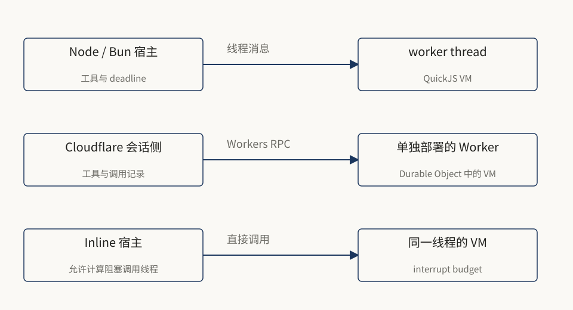

上游 README 记录了一项特定 Cloudflare 测试：让脚本持续计算十秒，放在会话对象内或由它加载的 Dynamic Worker 会延迟其他会话请求约十秒，单独部署的 Worker 则约为 50 ms。该数字来自上游环境测量，用来说明部署边界的选择，不保证本地环境或你的账号得到相同结果。

Cloudflare 还有两个限制需要单独理解：计算不 yield 时，墙钟 timeout 不足以约束 CPU，要使用 interrupt budget；远程 abort 可以先结束调用侧等待，VM 要到下一次工具调用或耗尽预算时才停。远程默认每 VM 32 MiB，不能套用普通 CLI 的 256 MiB。

`InlineCodemodeSandbox` 直接在调用线程运行，适合能接受阻塞的宿主。portable 入口不包含 Node imports，方便这些环境共用同一脚本 API。

### 11.3 Durable 恢复的是执行历史，不是 VM 内存快照

`pi-durable` 在 v0.99.2 的仓库中已经存在，最新区间新增的是与确定性脚本重放结合的 Code Mode 等能力。它是实验 API，版本间可随时变化。Harness 把会话条目、文档状态、任务和提交放进存储，提交后才发布相关状态；持久任务保存阶段检查点，重启后继续调度。[S23](#s23)

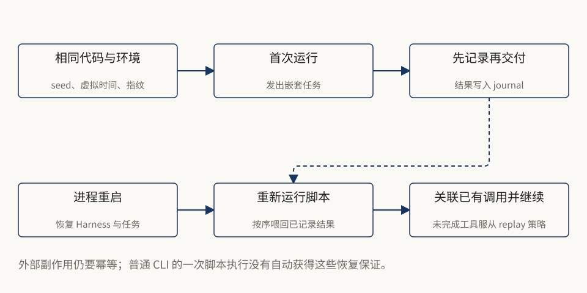

运行脚本时：

1. 固定虚拟时钟、随机种子、时区和 VM 指纹等条件。
2. 脚本发出嵌套工具调用，工具本身成为 Durable 任务。
3. 宿主在把结果交给 VM 之前，将结果与顺序写入 journal。
4. 进程崩溃后重新运行脚本，按原来顺序喂入记录的结果。
5. 脚本因此发出相同调用，按 key 重新关联已完成或仍在运行的任务，再继续新的工作。

`sandbox.start()` 的确定性约束包括：`Date.now()` 来自宿主提供的时间、随机性来自 seed、固定 UTC、不暴露 WeakRef/FinalizationRegistry、结果按宿主编号应用。它不要求保存整个 QuickJS 堆快照。[S13](#s13)、[S23](#s23)

### 一个“扣款后崩溃”的边界案例

假设工具向外部系统发起一笔扣款，外部扣款成功，但本地还没记录结果就崩溃。重启后能否再次调用？这不能靠“脚本可以重放”来决定。Durable 工具只有声明 `replay: "safe"` 才能在中断后重新执行，否则会产生 interrupted 错误。即便声明了 safe，外部副作用仍需服务端幂等 key 或查询确认。[S23](#s23)

所以它并不提供跨任意外部服务的“恰好一次副作用”魔法。它提供的是可记录、可检查、可恢复的调度和调用关系。代码路径改变、VM 指纹或 Code Mode 版本变化，以及 deadline 已经过期，都可能令重放报错，而不是盲目继续。

### 11.4 远程执行环境解决另一个问题

`pi-env` 把 Durable 工具的文件与命令操作转到远端机器：本地保留 Harness、存储和凭据；通过 SSH 启动小型 Rust daemon，运行协议化文件与进程操作。`RemoteExecutionEnv` 尽量保持与 `NodeExecutionEnv` 相同的语义。[S24](#s24)

这与把 QuickJS VM 放到远端是两个独立选择：VM 放在哪里，决定脚本计算在哪里；执行环境放在哪里，决定文件和命令在哪里发生。远程执行也不会自动成为沙箱，仍需限制远端账户权限、网络和可用凭据，并核验 SSH host key。

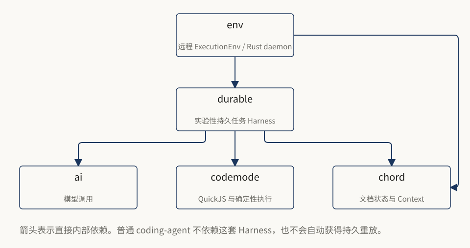

这张图应与第 3 章的 CLI 依赖图分开阅读：一个是实验性持久执行方案，一个是普通编码代理。两者复用模型和沙箱基础库，不意味着生命周期、状态格式和恢复契约相同。

# 第 12 章：迁移路线与动手实验

**本章目标：把概念变成能检查的操作，不在读完后只记得名词。**

### 12.1 从 v0.9.4 迁移，先选你实际使用的层

如果只是使用终端 CLI，备份会话与配置、确认新包名和运行环境，再逐步开启功能。当前 README 要求 Node.js 22.19 或更新；不要把旧仓库根目录的 Node 20 要求当作现版本要求。

如果嵌入的是旧 `Agent`，重点检查 transport API 到当前 `streamFn` / 消息转换接口的变化、旧附件模型、事件与并发语义。不要只替换 npm 包名就假定类型兼容。若依赖旧 `AgentHarness`，当前 `pi-agent-core` 已不再导出它，需要明确迁向 `AgentSession` 还是实验性 Durable。[S6](#s6)、[S22](#s22)

如果自定义过 hooks 与 tools，按当前 extension API 合并注册位置，并按事件的准确返回类型处理阻止、变换与通知。不要只把早年事件名机械替换成新名字而不检查契约。

### 12.2 从 v0.99.2 迁移，做一张小检查表

- [ ] 识别工具存在性用 `"name" in tools`，不靠读取未知成员。
- [ ] 发现 helper 全部有 `await`。
- [ ] shell 判断退出码，MCP 判断 `isError`。
- [ ] options 行确实在脚本第一行。
- [ ] 需要保存的图片调用 `image()`，不把 base64 当文本输出。
- [ ] 自定义沙箱资源池按真实 worker 退出释放容量，排队不重置总 deadline。
- [ ] `reserveTokens` 按触发阈值配置，不继续当摘要输出帽子。
- [ ] 图片分类核对 `input`、provider 图片协议、错误结果与 usage。
- [ ] 自定义编排器声明正确的 `reachesTools`。
- [ ] 旧 experimental harness 或 server/client 导出没有继续被引用。
- [ ] 恢复会话后验证活动工具与过滤策略，不仅看启动命令。
- [ ] SDK 明确添加需要的内置扩展并绑定生命周期。

### 12.3 在不改安装的情况下阅读本次下载

以下命令核对本机保留的研究副本；公开电子书不附完整 Git 目录。其他读者可先下载本版源码 ZIP，或按固定标签准备自己的副本。

```sh
# 在电子书仓库根目录执行。

git -C sources/pi-v1.4.0 describe --tags --exact-match
# v1.4.0

# 上一版参照仍保留：
git -C sources/pi-mono describe --tags --exact-match
# v1.3.0

git -C sources/pi-v0.9.4 describe --tags --exact-match
# v0.9.4

git -C sources/pi-v0.99.2 describe --tags --exact-match
# v0.99.2
```

`pi-mono-v1.4.0.zip` 是不包含依赖与 Git 历史的源码快照，方便离线拷贝。安装依赖或更新全局 Pi 是独立操作，本次没有执行。

### 实验 A：开启 Code Mode，但保留默认工具

在确认安装版本支持这些参数后，可运行：

```sh
pi --tools +codemode
```

或将下面字段**合并**到项目 `.pi/settings.json`，不要直接覆盖已有文件：

```json
{
  "defaultTools": ["+codemode"]
}
```

请模型读取几个小文件并只返回选中字段，观察一个外层 Code Mode 调用和多个嵌套调用。对比要求它把每个完整文件都输出时的结果大小。这里测试的是信息选择，不是证明任何固定 token 节省比例。

### 实验 B：不用模型，测试相同脚本的控制流

本书提供 `examples/run-checks.mjs`，使用 Node 内置断言和模拟工具运行脚本文件：

```sh
node examples/run-checks.mjs
```

它检查并行读取与字段筛选、部分失败保留、非零 shell 退出码、成功/失败状态提交、图片分类的成功与失败契约，以及输出减量算术。它不是 QuickJS 的安全测试，不调用外部服务，也不能证明 MCP 或真实沙箱没有缺陷。Code Mode 脚本放在 `examples/scripts/`，可以阅读，也可以交给 Pi 使用。

### 实验 C：观察分支与外部世界的区别

在临时项目里执行一个脚本，保存小游标并写入测试文件。回到保存前的会话节点创建另一分支，再 `load()`：游标沿新分支重建，但文件不会因此恢复。只使用可丢弃文件，不要拿生产数据做这个实验。

### 实验 D：按官方 SDK 示例接上 MCP

`examples/sdk-codemode-mcp.ts` 是固定版本官方示例的副本。重点阅读三处：`extensionFactories` 安装三个内置扩展；`defaultTools` 增量启用；`session.bindExtensions({})` 发出启动事件。真正运行还需要当前包、凭据和 MCP 配置。本次没有自动执行付费模型调用，也没有添加服务器。

### 五个问题，检查是否真的理解

1. **Code Mode 是否等于多个工具并行？** 不等于。新版普通调用也能并行；Code Mode 多了程序控制流和中间结果筛选。
2. **脚本失败，之前写文件会撤销吗？** 不会。成功才提交的小 store 与外部文件写入没有统一事务。
3. **MCP Promise fulfilled 是否意味着成功？** 不意味着。还要检查 `isError`。
4. **普通 CLI 恢复会话是否会从脚本中断的语句继续？** 没有这个通用保证。Durable Code Mode 通过日志和确定性重放提供另一种恢复机制。
5. **QuickJS 没有文件系统，shell 就安全吗？** 不能这样推断。注入工具背后的权限才决定影响范围。

### 常用词，放回各自的位置

| 词 | 在本书中的含义 |
|---|---|
| Agent loop | 模型响应、工具执行、下一轮判断的循环 |
| Harness | 循环外围的上下文、状态、资源和生命周期设施 |
| AgentSession | 普通编码代理中拥有会话及运行状态的对象 |
| Turn | 一次模型响应及其工具调用 |
| Run | 一次输入引发的一个或多个回合及收尾 |
| Exposure | 工具如何被模型看见、如何被其他工具调用 |
| Loadout | 当前声明和可调用工具的配置视图 |
| Nested call | 由工具内部发起、结果先返回调用者的调用 |
| Projection | 从持久历史构建出的模型可见上下文 |
| QuickJS / WASM | JavaScript 引擎及其在沙箱中的运行载体 |
| Journal / replay | 记录已交付结果，再按确定顺序重放 |
| Idempotency | 重试同一业务操作不重复产生不可接受副作用的契约 |

### 接下来沿源码读哪几处

从普通 CLI 入手，先读 `how-pi-works.md` 和 `sdk.md`，再读 Code Mode 文档、`tool.ts` 与 `execute.ts`。想把脚本能力放进自己的产品，优先读独立 `codemode/README.md`。只有确实需要跨重启任务恢复，再进入 Durable 的 README 和规范，不要一开始就把实验 runtime 当作必要前置。

所有图都按职责做了适度简化。各模块内部的重试、流式事件和 schema 细节应回到下一节的固定版本来源核对。


# 来源索引与核查范围

所有文件链接固定到对应版本标签。方括号来源编号可从正文跳转；源码副本位于同目录 `sources/`。

<div class="source" id="s1">

**[S1] [最新发布与固定标签](https://github.com/earendil-works/pi/releases/tag/v1.4.0)**

本版正式发布端点：v1.4.0，2026-10-21；详细元数据见 versions.json。

</div>

<div class="source" id="s2">

**[S2] [coding-agent 版本变更日志](https://github.com/earendil-works/pi/blob/v1.4.0/packages/coding-agent/CHANGELOG.md)**

版本时间线、Code Mode/MCP 引入、1.0 至 1.4 的功能与修复。

</div>

<div class="source" id="s3">

**[S3] [旧版有状态 Agent](https://github.com/earendil-works/pi/blob/v0.9.4/packages/agent/src/agent.ts)**

transport.run、消息转换、事件与队列。

</div>

<div class="source" id="s4">

**[S4] [旧版 ai 包中的工具循环](https://github.com/earendil-works/pi/blob/v0.9.4/packages/ai/src/agent/agent-loop.ts)**

校验、顺序工具执行、回合循环。

</div>

<div class="source" id="s5">

**[S5] [旧版线性 SessionManager](https://github.com/earendil-works/pi/blob/v0.9.4/packages/coding-agent/src/session-manager.ts)**

JSONL 记录与复制到新文件的分支方式。

</div>

<div class="source" id="s6">

**[S6] [当前 Agent 核心文档](https://github.com/earendil-works/pi/blob/v1.4.0/packages/agent/README.md)**

消息变换、事件、并行默认执行及顺序保证。

</div>

<div class="source" id="s7">

**[S7] [How Pi Works](https://github.com/earendil-works/pi/blob/v1.4.0/packages/coding-agent/docs/how-pi-works.md)**

当前主运行链、上下文、会话和接口。

</div>

<div class="source" id="s8">

**[S8] [普通 CLI 包清单与依赖](https://github.com/earendil-works/pi/blob/v1.4.0/packages/coding-agent/package.json)**

依赖精确固定；不依赖 pi-durable、pi-env 或 chord。其他包的 package.json 同保存在下载源码中。

</div>

<div class="source" id="s9">

**[S9] [SDK 生命周期与状态](https://github.com/earendil-works/pi/blob/v1.4.0/packages/coding-agent/docs/sdk.md)**

AgentSession、SessionManager、agent_settled、资源加载与内置扩展差异。

</div>

<div class="source" id="s10">

**[S10] [Code Mode 用户与脚本契约](https://github.com/earendil-works/pi/blob/v1.4.0/packages/coding-agent/docs/codemode.md)**

全局接口、返回值、输出、store、models 与限制。

</div>

<div class="source" id="s11">

**[S11] [当前会话文件格式](https://github.com/earendil-works/pi/blob/v1.4.0/packages/coding-agent/docs/session-format.md)**

树形条目、压缩、context_edit、自定义状态、上下文投影。

</div>

<div class="source" id="s12">

**[S12] [压缩机制](https://github.com/earendil-works/pi/blob/v1.4.0/packages/coding-agent/docs/compaction.md)**

阈值、保留边界、摘要、分支总结与恢复。

</div>

<div class="source" id="s13">

**[S13] [独立 Code Mode 沙箱库](https://github.com/earendil-works/pi/blob/v1.4.0/packages/codemode/README.md)**

worker 与 QuickJS、独立使用、Cloudflare、确定性 start 和结果契约。

</div>

<div class="source" id="s14">

**[S14] [Code Mode executor 实现](https://github.com/earendil-works/pi/blob/v1.4.0/packages/coding-agent/src/extensions/codemode/execute.ts)**

ctx.executeTool 调用链、结果适配、状态提交、worker 数量控制。

</div>

<div class="source" id="s15">

**[S15] [扩展、嵌套调用与工具契约](https://github.com/earendil-works/pi/blob/v1.4.0/packages/coding-agent/docs/extensions.md)**

exposure、prepareLoadout、reachesTools、状态、事件与权限扩展。

</div>

<div class="source" id="s16">

**[S16] [MCP 接入与 exposure](https://github.com/earendil-works/pi/blob/v1.4.0/packages/coding-agent/docs/mcp.md)**

命名、连接时机、发现、过滤、完整 MCP 返回对象、OAuth 与替换扩展。

</div>

<div class="source" id="s17">

**[S17] [设置与工具呈现](https://github.com/earendil-works/pi/blob/v1.4.0/packages/coding-agent/docs/settings.md)**

defaultTools、codemode.mode、inlineBudget、TUI 与会话设置。

</div>

<div class="source" id="s18">

**[S18] [删除未发布的实验服务栈](https://github.com/earendil-works/pi/commit/7472cda0d6e51dfbf53c03f46b47aa42ac64bf64)**

2026-10-12：客户端、协议、服务端实验栈清理；不等于正式 CLI 换内核。

</div>

<div class="source" id="s19">

**[S19] [命令行参考](https://github.com/earendil-works/pi/blob/v1.4.0/packages/coding-agent/docs/cli.md)**

启用 Code Mode、增量工具选择、MCP 排除、运行模式。

</div>

<div class="source" id="s20">

**[S20] [官方 SDK Code Mode/MCP 示例](https://github.com/earendil-works/pi/blob/v1.4.0/packages/coding-agent/examples/sdk/14-codemode-mcp.ts)**

添加三个内置扩展、启用工具、bindExtensions、释放资源。

</div>

<div class="source" id="s21">

**[S21] [独立 Code Mode 包的版本变化](https://github.com/earendil-works/pi/blob/v1.4.0/packages/codemode/CHANGELOG.md)**

start、portable、remote、未知成员、冻结内建对象、close 与 worker 生命周期。

</div>

<div class="source" id="s22">

**[S22] [Agent 包迁移与清理记录](https://github.com/earendil-works/pi/blob/v1.4.0/packages/agent/CHANGELOG.md)**

旧 transport 删除、并行工具执行、1.0.0 移除实验 harness 导出。

</div>

<div class="source" id="s23">

**[S23] [实验性 Durable Harness](https://github.com/earendil-works/pi/blob/v1.4.0/packages/durable/README.md)**

任务与存储、Code Mode journal/replay、幂等与 replay 策略、独立 API。

</div>

<div class="source" id="s24">

**[S24] [远程执行环境 pi-env](https://github.com/earendil-works/pi/blob/v1.4.0/packages/env/README.md)**

SSH、Rust daemon、RemoteExecutionEnv、host key 与远程语义。

</div>

<div class="source" id="s25">

**[S25] [安全与项目可信决策](https://github.com/earendil-works/pi/blob/v1.4.0/packages/coding-agent/docs/security.md)**

无默认逐调用审批；OS 权限、容器、可信资源与 prompt injection 边界。

</div>

<div class="source" id="s26">

**[S26] [v1.4.0 worker 排队与容量准入](https://github.com/earendil-works/pi/blob/v1.4.0/packages/coding-agent/src/extensions/codemode/execute.ts)**

reserveCodemodeWorker、FIFO 放行、60 秒等待、总 deadline 与 PI_CODEMODE_MAX_WORKERS。

</div>

<div class="source" id="s27">

**[S27] [v1.4.0 分类器图片能力与供应商边界](https://github.com/earendil-works/pi/blob/v1.4.0/packages/coding-agent/docs/models.md)**

input 能力、图片格式、System One 接入差异、usage 与费用。

</div>

<div class="source" id="s28">

**[S28] [v1.4.0 摘要输出预算实现](https://github.com/earendil-works/pi/blob/v1.4.0/packages/coding-agent/src/core/compaction/compaction.ts)**

移除固定输出比例帽子，保留旧函数参数位置，将自定义指令传入回合前缀摘要。

</div>

<div class="source" id="s29">

**[S29] [v1.4.0 Models Configuration 字段参考](https://github.com/earendil-works/pi/blob/v1.4.0/packages/coding-agent/docs/models-configuration.md)**

从 schema 生成的 provider、模型和兼容字段，含分类器图片协议选项。

</div>

## 核查范围与限制

本书对照官方发布 API、四个固定标签、相关包清单、主运行链文档、核心循环及 Code Mode 适配实现，保存了完整 diff 清单。书中代码区分可运行示例与占位伪代码。

教学脚本使用 Node 和模拟工具验证。HTML、PDF、EPUB 另做渲染或结构检查。没有运行完整上游测试套件，没有部署 Cloudflare 或 SSH 环境，没有用付费模型验证生成质量，没有做沙箱安全审计；上游测量数据明确标注为上游结果。

优先深入阅读：S7 建立全景；S10 理解脚本契约；S13 研究独立沙箱和部署；S15 理解嵌套工具与扩展；S23 理解实验性持久执行。

## 固定提交

- `v0.9.4`：`a484330cd15e5844dfa42a4749594067128ea0c1`
- `v0.99.2`：`005af57d88ee23b33778f343a9595b32e67ff788`
- `v1.3.0`：`71023aec1546d6d677a65669c5665c0927ce0dd0`
- `v1.4.0`：`4a080252f06caf63a525d7873c5d94d3c23887e0`

来源材料为官方仓库中的文档与源码；电子书是整理后的教学解释，不代表项目官方文档。
